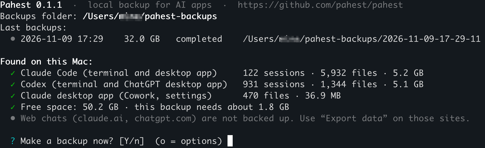

A backup is one command and one answer. This page shows a real run on a Mac with about 1,050 sessions. Only the user name is changed, to `you`.

## Start Pahest

Open the Terminal app, type `pahest`, and press Enter. Pahest shows the start screen. It copies nothing before you answer its question.

<Frame>
  
</Frame>

| Line | What it tells you |
| --- | --- |
| `Backups folder` | The folder for your backups. |
| `Last backups` | Your last backups, with the time, the size and the result. |
| `Found on this Mac` | Each app that Pahest can back up, with the number of its sessions and files. |
| `Free space` | The free space on the disk, and the minimum new space for this backup. |

## Answer the question

| Key | Result |
| --- | --- |
| Enter, or `y` | The backup starts. |
| `n` | Pahest stops and prints `Cancelled. Nothing was backed up.` |
| `o` | Pahest shows the [options](/commands#the-options-at-the-question). |

## Read the result

Press Enter. Pahest shows its progress for each app and asks no more questions. These are the first and the last lines of the run:

```text
  ? Make a backup now? [Y/n]  (o = options)

  • The backup starts now. Press Ctrl+C to stop it at any time; what is saved by then is kept.

── Claude Code ─────────────────────────────────────────────────────────────────────────────────────
  Claude Code        ████████████████████████ 100%  5,984/5,984  5.3 GB/5.3 GB
  ✓ local sessions: ok · 124 sessions · 5,984 files · 5.3 GB
    → /Users/you/pahest-backups/2026-11-11-19-23-42/claude-code

…

── Verification ────────────────────────────────────────────────────────────────────────────────────
  Verifying          ████████████████████████ 100%  29,636/29,636  32.7 GB/32.7 GB
  ✓ 29,636 files (32.7 GB) read back and matched; 698 JSON, 1,667 JSONL, 931 compressed, 5 databases, 17,704 images checked

── Done ────────────────────────────────────────────────────────────────────────────────────────────
✓ Backup completed in 23:21: 29,637 files, 32.7 GB (3.7 GB written in full, the rest stored as clones).

  Backup folder:  /Users/you/pahest-backups/2026-11-11-19-23-42
  Your chats:     file:///Users/you/pahest-backups/2026-11-11-19-23-42/index.html
  Report:         file:///Users/you/pahest-backups/2026-11-11-19-23-42/report.html
  All backups:    file:///Users/you/pahest-backups/logs/index.html
  To open a link, hold Cmd and click it (in Apple's Terminal: hold Cmd and double-click).
```

This run took 23 minutes because the Mac did other work at the same time.

The first line of the part `Done` gives the result:

| Text | Meaning |
| --- | --- |
| `Backup completed` | The backup has all files and no problems. |
| `Backup completed with problems` | A part is missing. See [Problems and limits](/problems#the-backup-completed-with-problems). |

## Open your sessions

Hold Cmd and click the address in the line `Your chats`. In the Terminal app from Apple, hold Cmd and double-click it. The list of your sessions opens in your browser.

You can also open the page from Finder:

1. Run `open ~/pahest-backups`.
2. Open the folder with the newest date.
3. Double-click `index.html`.

[Find a session](/sessions) shows what you can do on that page.

## Stop a backup

Press Ctrl+C. Pahest stops and keeps the files that it saved before you stopped it. It adds `-interrupted` to the name of that backup folder. To get a full backup, run `pahest` again.

## Make the next backup

Run `pahest` again. Each run makes a new, full backup in a new folder. The name of the folder is the date and time of the start.
