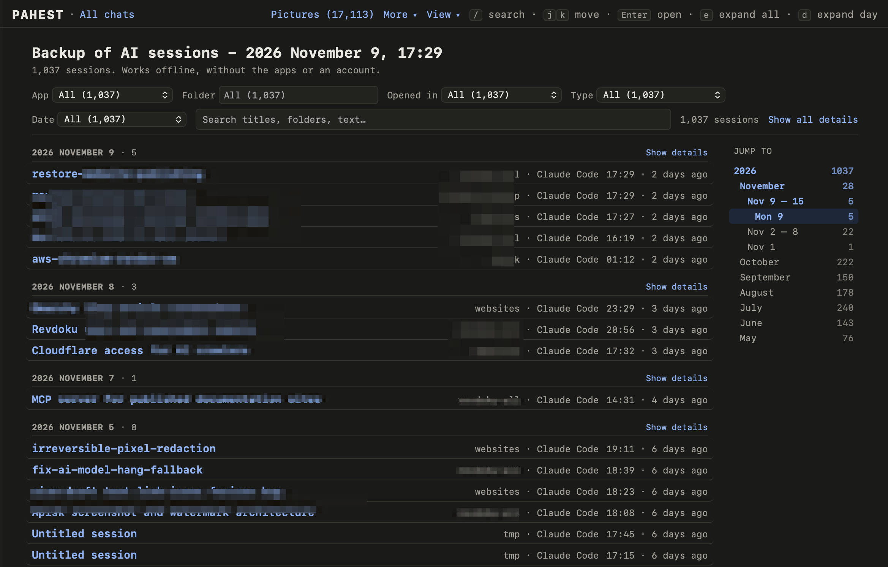

Pahest makes a local backup of your sessions with Claude Code and Codex on a Mac. A session is one conversation with the AI. Pahest also makes web pages from the backup, so you can read and search your sessions offline.

*Pahest* is the Armenian word պահեստ (say “pa-HEST”). It means “reserve”.

<Frame>
  
</Frame>

## The apps

| App | What Pahest saves |
| --- | --- |
| Claude Code (terminal and desktop app) | The sessions, the pasted pictures and your settings. |
| Codex (terminal, code editor extension and ChatGPT desktop app) | The sessions, the pictures and your settings. |
| Claude desktop app | The Cowork files and the settings of the app. |

[What a backup holds](/backup-content) has the full list.

## Before you start

- Pahest does not back up your projects. It saves the sessions, not the code and the documents in your project folders.
- Pahest only reads the files of the apps. It does not change them.
- Pahest does not connect to the internet.
- Pahest does not save your chats on claude.ai and chatgpt.com. They are not on your Mac.
- Pahest is free and open source (MIT license). It is not affiliated with Anthropic or OpenAI.

## Start

<CardGroup cols={3}>
  <Card title="1. Install" href="/install">
    Install Pahest with Homebrew.
  </Card>
  <Card title="2. Make a backup" href="/first-backup">
    Run one command and answer one question.
  </Card>
  <Card title="3. Read it" href="/sessions">
    Search and filter your sessions.
  </Card>
</CardGroup>
