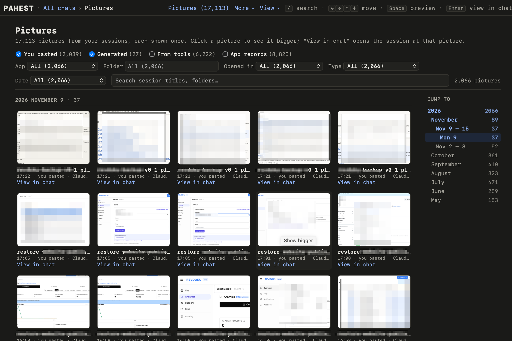

The Pictures page shows every picture from every session. To open the page, click **Pictures** in the top bar of a page.

<Frame>
  
</Frame>

## Choose the pictures

Four checkboxes choose the kinds of pictures. The page starts with **You pasted** and **Generated**.

| Checkbox | Pictures |
| --- | --- |
| **You pasted** | Pictures that you pasted into a session. |
| **Generated** | Pictures that the AI made. |
| **From tools** | Pictures that the AI looked at, for example a screenshot from a tool. |
| **App records** | Pictures from the records of the app, for example the browser screenshots of Codex. |

The page also has the filters and the search box of the list of sessions. [Find a session](/sessions) shows how to use them.

## Look at a picture

- Click a picture to see it large.
- Press the left or the right arrow key to go to the previous or the next picture.
- Press Space or Esc to close the picture.
- Click **View in chat** to open the session at that picture.

## Use the keyboard

| Key | Result |
| --- | --- |
| `/` | Go to the search box. |
| Arrow keys | Move from picture to picture. |
| Space | Show the selected picture large, or close it. |
| Enter | Open the session at the selected picture. |
