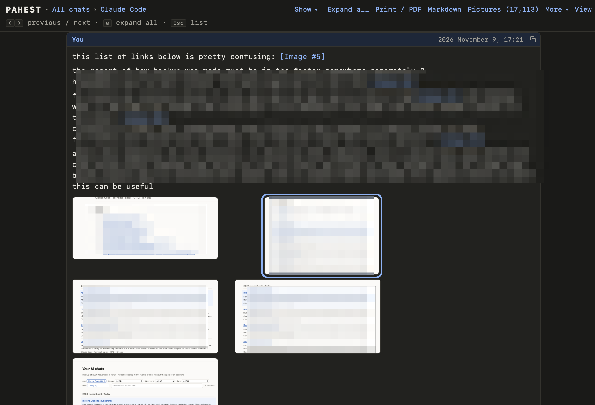

Each session has its own page. The page shows the full conversation: your messages, the answers, the tool calls and the pictures.

<Frame>
  
</Frame>

## The top of the page

Under the title, the page shows facts about the session: the app, the folder, the Git branch, the times, the model and the version of the app. **In this backup** is a link to the raw transcript. The raw transcript is the session file of the app, without a change.

## The conversation

The page shows each part of the conversation as a block:

- Your messages have the label **You**.
- Each answer of the AI is one block.
- The thinking of the AI is folded. Click it to open it.
- Each tool call is a card with its result. A tool call is a command, a file edit or a search that the AI made.
- Text that the app added is folded under **Added by Claude Code** or **Added by Codex**.

Long messages, results and code blocks are folded. Click **Expand** to see one in full. To open all blocks, click **Expand all** in the top bar or press `e`.

Click a picture to see it large. Press Esc to close it.

## Show only some parts

The **Show** menu in the top bar chooses what the page shows:

- **Your messages**
- **AI answers**
- **Thinking**
- **Tool calls and results**
- **Added by the app**
- **Pictures**

The menu also has three quick choices: **Only my messages**, **Conversation only** and **Everything**. The page keeps your choice for the next sessions. Print and copy use your choice too.

## Copy, print and Markdown

| To do this | Do this |
| --- | --- |
| Copy a message or a code block | Point at it and click its copy button. |
| Print the session, or save it as a PDF | Click **Print / PDF** in the top bar, or press Cmd+P. |
| Open the session as a Markdown file | Click **Markdown** in the top bar. |

## Move between sessions

**← Previous** and **Next →** open the previous and the next session of the list that you came from. **↑ List** goes back to the list, with your filters.

| Key | Result |
| --- | --- |
| Left and right arrows, or `k` and `j` | Open the previous or the next session. |
| `e` | Open or close every folded block. |
| Esc | Go back to the list. |
