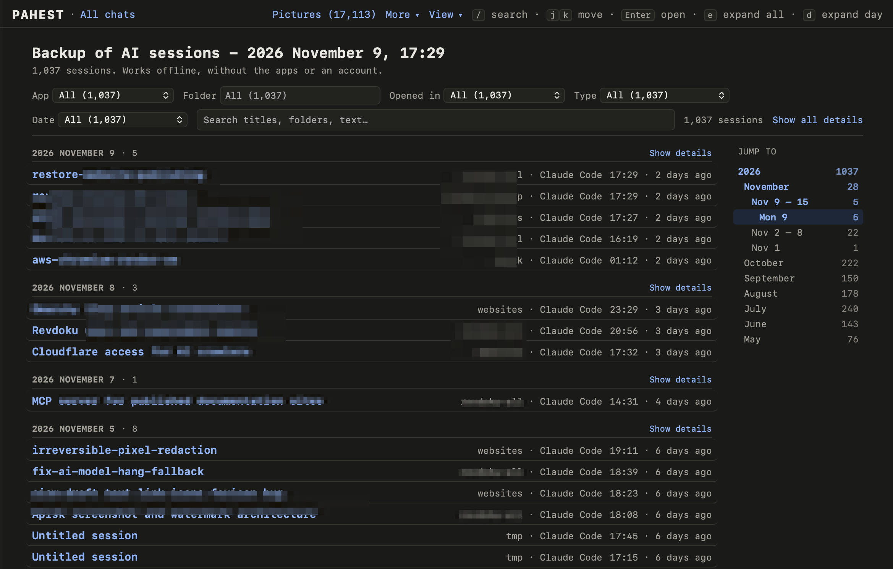
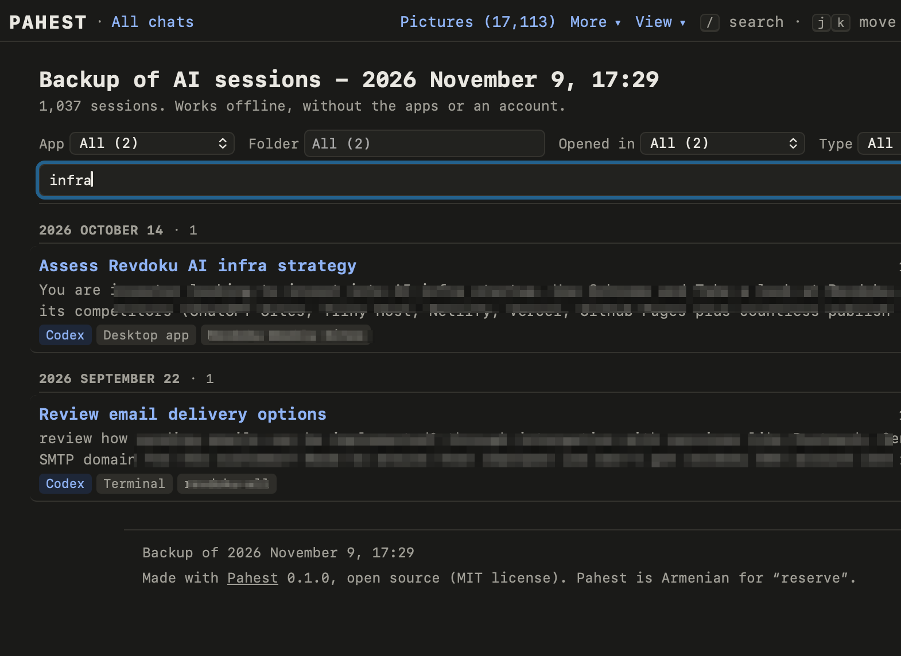
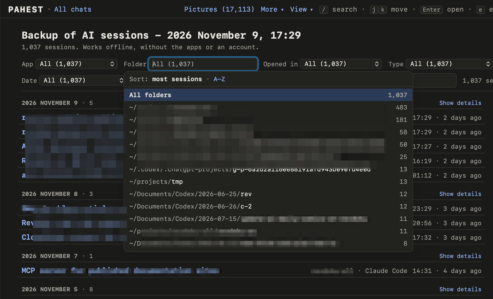
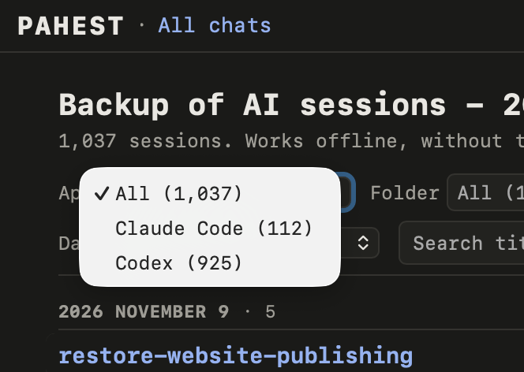
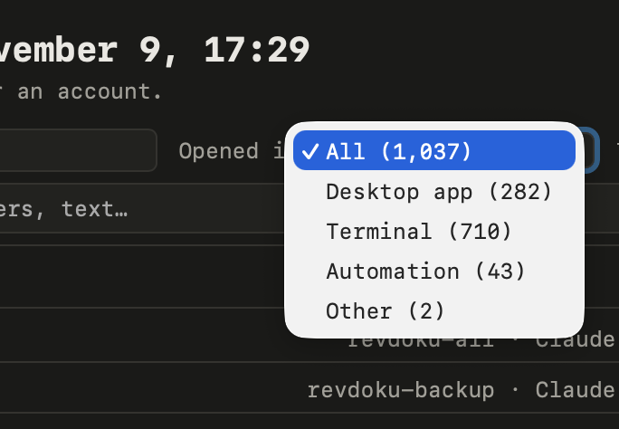
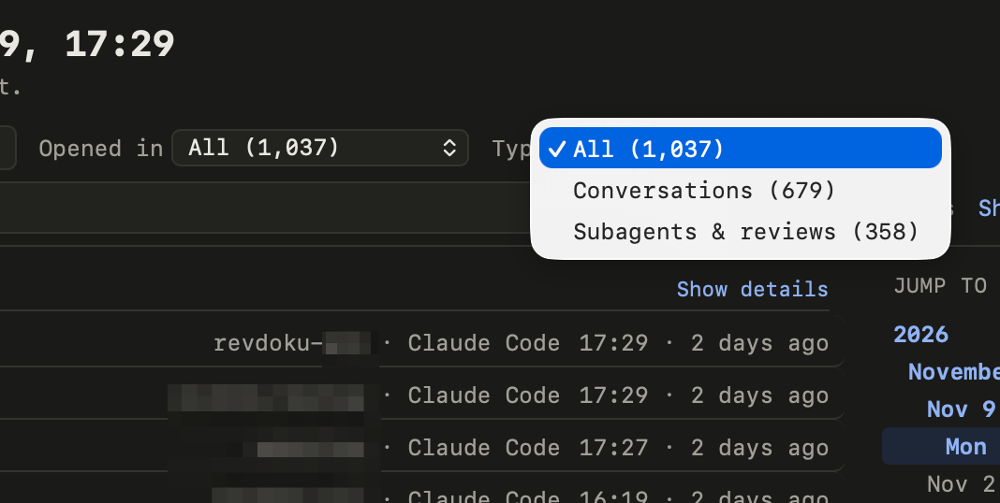

The first page of a backup is `index.html` in the backup folder. It lists every session from every app.

<Frame>
  
</Frame>

## Read the list

The list shows the newest sessions first, in groups by day. Each session has one line with the title, the folder, the app and the time.

- Click the title to open the session.
- Click **Show details** next to a day to see the start of the first message and the tags of each session.
- Click a folder, an app or a tag to show only the sessions that have it. Click it again to show all sessions.

## Search

Type words in the search box. The list then shows only the sessions that have these words in the title, in the folder, or in the start of the conversation.

<Frame>
  
</Frame>

## Filter the list

Five filters are above the list. You can use more than one filter, and you can use them together with the search box. **Reset** clears all the filters and the search.

| Filter | Choices |
| --- | --- |
| **App** | Claude Code, Codex or Claude desktop. |
| **Folder** | The project folder of the session. Type a part of the path, or choose a folder from the list. |
| **Opened in** | Desktop app, Terminal, Code editor, or Automation. Automation means that another program started the session. |
| **Type** | Conversations with you, or subagents and reviews. A subagent is a session that an app started by itself. |
| **Date** | Today, Yesterday, Last 7 days, Last 30 days, or Year to date. |

<Frame>
  
</Frame>

<Frame>
  
</Frame>

<Frame>
  
</Frame>

<Frame>
  
</Frame>

## Go to a date

On a wide window, **Jump to** at the right lists the years, the months, the weeks and the days. Click a line to go to that date.

## Use the keyboard

| Key | Result |
| --- | --- |
| `/` | Go to the search box. |
| `j` and `k`, or the down and up arrows | Move through the list. |
| Enter | Open the selected session. |
| `e` | Show or hide the details of every day. |
| `d` | Show or hide the details of the selected day. |

## The top bar

Every page of a backup has the same bar at the top:

| Part | Result |
| --- | --- |
| **All chats** | Goes to the list of all sessions. |
| **Pictures** | Opens the [Pictures page](/pictures). |
| **More** | Opens the other pages of the backup: the backup report, the text that you typed in each app, and the Codex databases. |
| **View** | Sets the colors (**Auto**, **Light** or **Dark**) and the font (**Mono**, **Sans** or **Serif**). |

On a session page, the name of the app in the bar opens the list of that app.
